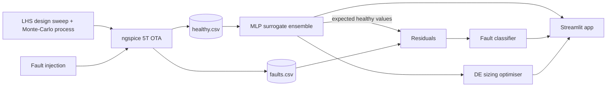

# Analog Surrogate + Fault Diagnosis for a 5T OTA

An ML surrogate that replaces ngspice for a 5-transistor OTA (gain, bandwidth, phase margin, power, DC
operating point), extended with component-level **fault diagnosis** and **surrogate-assisted sizing**.
Everything is generated from ngspice with a self-contained Level-1 model, so there is no PDK or paid tool.

## Results (6,000 healthy sims, 3,600 train / 1,200 test fault sims)

| What | Result |
|---|---|
| Surrogate accuracy (held-out test, MLP ensemble) | Gain 0.17 % MAPE, UGBW 1.0 % (linear), PM 0.12 %, Power 1.1 %, R² >= 0.998 on all six outputs |
| Baselines (MAPE on power) | Ridge 16.8 %, Random Forest 15.9 %, MLP ensemble 1.1 % |
| Speed, 1,000 evaluations | ngspice 6.1 s (single core) vs surrogate 5.6 ms batched (about 1,100x) or 0.22 s one call at a time (about 28x) |
| Fault classes | healthy, M1 D-S short, M4 gate open, bias low, Vth drift, load-cap shift |
| Fault accuracy by feature set | measured only 85 %, measured + design 98.6 %, **measured + surrogate residuals 100 %** |
| Fault accuracy under measurement noise | 1 % noise 100 %, 2 % noise 100 %, 5 % noise 98.6 % (noise-augmented training) |
| Sizing (gain>=45 dB, UGBW>=80 MHz, PM>=60), min power | surrogate DE + 1 ngspice check: **18.0 uW** vs 25.0 uW (DE on ngspice, 600 calls) vs 26.1 uW (random search, 600 calls) |

Figures are in `reports/figures/`, raw numbers in `reports/*.json`.

**Honest caveats.** The speed-up depends on how fast ngspice is for this tiny circuit (about 6 ms/run); for bigger circuits
with transient or Monte-Carlo runs the gap grows a lot. Fault classes are fairly strong and the simulator is noise-free, so
the near-perfect accuracy is an upper bound; the noise test shows how it degrades. Level-1 models are simple, so absolute
numbers are not tied to a real process, but the method carries over to a PDK such as sky130 by changing the netlist template.

## Architecture



**Key idea:** the surrogate says what a *healthy* circuit with these design parameters should measure. The difference
between that and what is actually measured (the residual) is a very strong fault signature, which is why residual
features beat raw measurements in the ablation.

## Circuit

```
              VDD
       ┌───────┴───────┐
     M3 ┤├─┬────────┬─┤├ M4          M3, M4: PMOS mirror load
        │  │        │  │
        └──┤ d1     └──┼───── out ── CL
           │           │
     M1 ┤├──┘        └──┤├ M2         M1, M2: NMOS input pair
    inp         tail      inn
                 │
              M5 ┤├── bias mirror (M0 diode + IREF)
                 │
                GND
```
Inputs: W/L of the pair and the load, bias current, mirror ratio, load cap, VDD, temperature, plus four process-variation
shifts (dVth and dKp for NMOS and PMOS). Outputs: DC gain, UGBW, phase margin, power, Vout, Vtail.

## Project structure

```
analog-surrogate/
├── README.md
├── requirements.txt
├── Makefile
├── run_all.py                  # whole pipeline, cross-platform
├── netlists/
│   └── ota_template.sp         # parametric ngspice netlist (placeholders filled by Python)
├── otaml/
│   ├── config.py               # paths, parameter ranges, fault classes
│   ├── netlist.py              # template -> concrete netlist (+ fault)
│   ├── faults.py               # 5 fault models with random severity
│   ├── simulate.py             # runs ngspice, parses .meas results
│   ├── sampling.py             # Latin Hypercube + gaussian process shifts
│   ├── generate_dataset.py     # multiprocessing dataset builder
│   ├── features.py             # log transforms, NaN handling, residuals
│   ├── surrogate.py            # MLP ensemble wrapper (fit/predict/save)
│   ├── train_surrogate.py      # training, baselines, plots
│   ├── classifier.py           # feature sets, noise model, FaultDiagnoser
│   ├── train_classifier.py     # training, ablation, noise robustness
│   ├── benchmark.py            # SPICE vs surrogate speed + accuracy
│   └── optimize.py             # surrogate-assisted sizing vs baselines
├── app/app.py                  # Streamlit demo
├── tests/test_smoke.py
├── data/                       # generated CSVs
├── models/                     # generated .joblib files
└── reports/                    # metrics JSON + figures
```

## Setup and run

```bash
# 1) ngspice
#    Linux:   sudo apt install ngspice
#    macOS:   brew install ngspice
#    Windows: install from https://ngspice.sourceforge.io/download.html
#             then:  set NGSPICE_BIN=C:\path\to\ngspice_con.exe

# 2) Python deps
python -m venv .venv && source .venv/bin/activate      # Windows: .venv\Scripts\activate
pip install -r requirements.txt

# 3) Whole pipeline (about 2 minutes on one core; use --quick for a 20 s smoke run)
python run_all.py

# 4) Demo
streamlit run app/app.py

# 5) Tests
pytest -q
```

Individual steps: `python -m otaml.generate_dataset --n-healthy 6000 --n-per-fault 800`, then
`train_surrogate`, `train_classifier`, `benchmark`, `optimize --gain 45 --ugbw 80e6 --pm 60`.

## Demo tabs

1. **Surrogate:** move sliders, get instant specs, click *Verify with ngspice* to see the error.
2. **Fault diagnosis:** pick a fault, set measurement noise, simulate and see class probabilities and the residual table.
3. **Auto-sizing:** enter specs, the optimiser returns a design and verifies it in ngspice.
4. **Results:** all figures and benchmark numbers.

## Ideas to extend

- Swap the Level-1 models for sky130 or PTM and re-run the pipeline.
- Add a second circuit (folded cascode) and check transfer of the method.
- Raw-waveform 1D-CNN on AC/transient responses, using the feature-based model as the baseline.
- Surrogate uncertainty (ensemble variance) to decide when to fall back to a real SPICE run.

## Resume bullets

- Built an ML surrogate for a 5T OTA from 6,000 ngspice simulations (Latin Hypercube + process Monte-Carlo): predicts gain, UGBW, phase margin and power with 0.1 to 1.1 % MAPE and about 1,100x batch speed-up over SPICE.
- Developed component-level fault injection (5 fault types) and a classifier using surrogate-residual features; 100 % test accuracy (98.6 % at 5 % measurement noise) vs 85 % with raw measurements alone.
- Implemented surrogate-assisted analog sizing (differential evolution) that met gain, bandwidth and phase-margin specs with 28 % lower power than SPICE-in-the-loop baselines using one SPICE verification.
- Shipped an interactive Streamlit app for performance prediction, fault diagnosis and auto-sizing.
